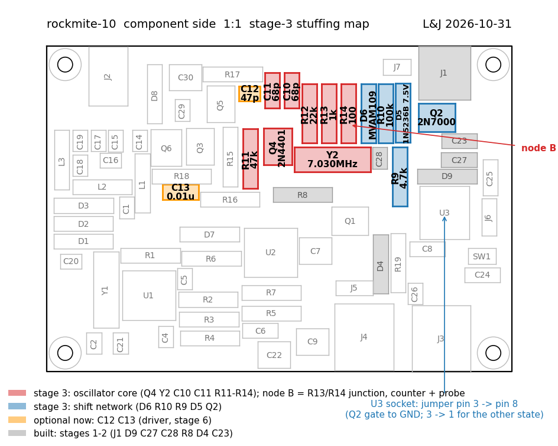
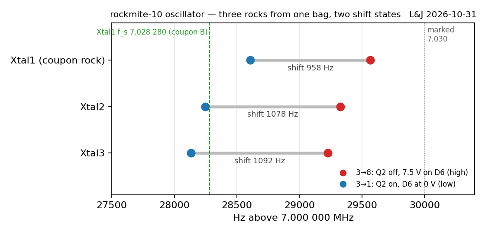
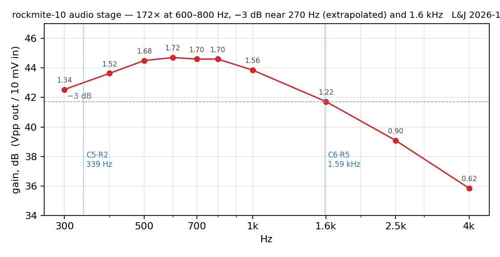
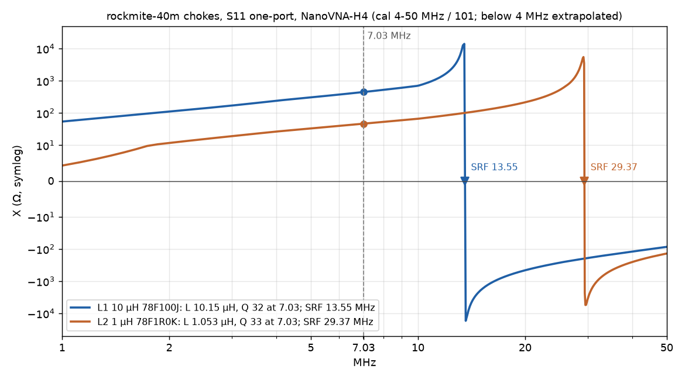
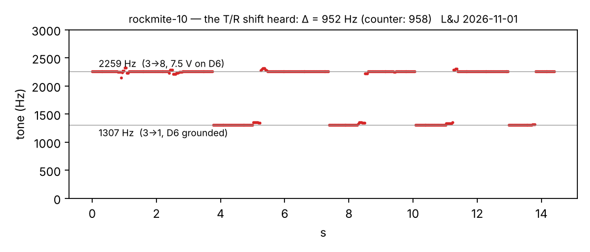
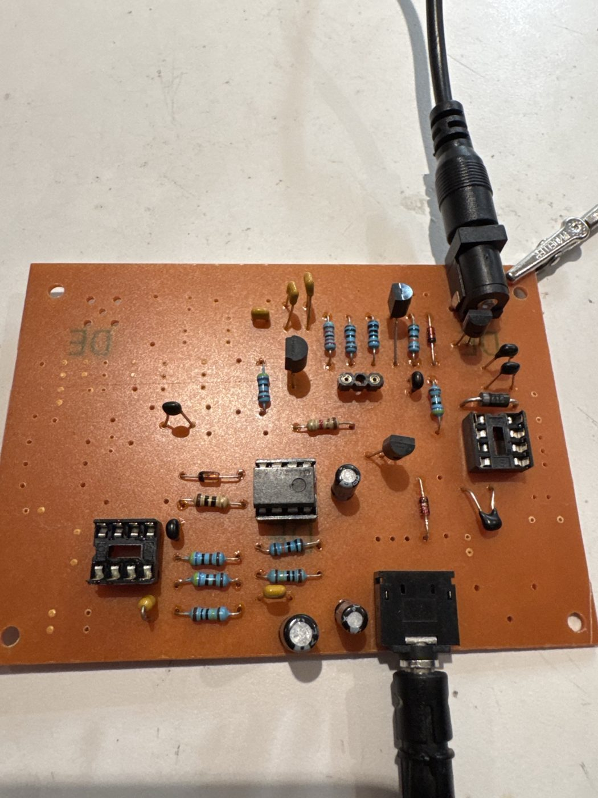
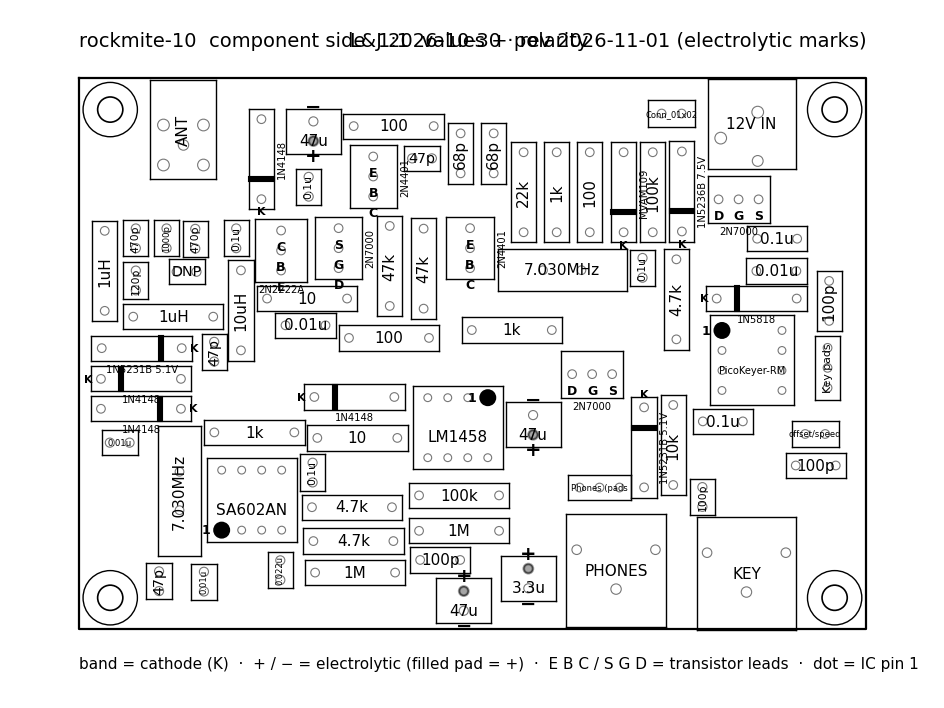
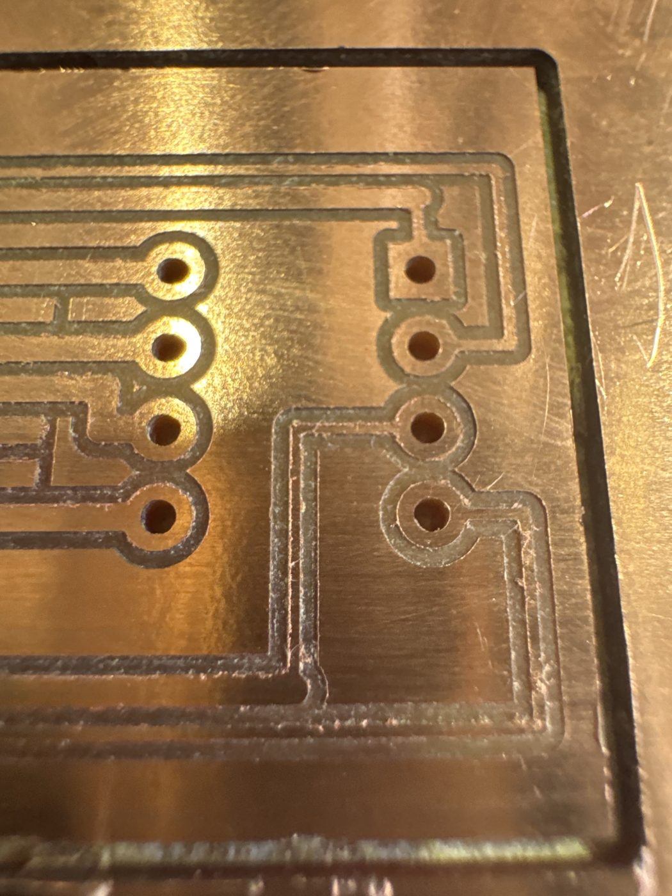

Board **rockmite-10**, stuffed in stages over 31 October and 1 November, each stage measured before the next went on. This page is what the counter, the scope and the headphones said.
{: .margin}

The order was the one the oscillator dictated: power first, then the 5 V keyer rail, then the oscillator and its shift network together — the crystal's cold end returns through the varactor, so the shift parts are not optional for the oscillator to run at all. Then the audio stage, then the mixer and front end. The transmitter is still to come.

Each stage got a 1:1 stuffing map generated from the board file: the stage's parts in colour, everything already built in grey. Cheap to make, and it stopped a lot of squinting at the values sheet.
{: .margin}

## The oscillator, and three crystals

The Colpitts around Q4 started first time: a peaky 5.2 V pp at the emitter, **7.029 566 MHz** on the counter with 7.5 V on the varactor, **7.028 608** with the varactor grounded — the two states the keyer will switch between. That is a **958 Hz** transmit/receive shift from this crystal and this MVAM109. Supply 14 mA; the 7.5 V zener reads 7.39 V at the 1 mA R9 gives it.

Because the crystal sits in socket pins, two more 7.030 rocks from the same bag went in:

Three hundred and forty hertz of spread across the bag — about 50 ppm, ordinary for cheap HC-49s — and the pull swing differs by 130 Hz between them. The coupon rock, whose series resonance was measured on the last page, sits highest and swings least. This is the first page of a crystal-matching sheet, which is a jig I now want to build.
{: .margin}

## The audio stage is a filter

With the mixer not yet in, the op-amp's + input was borrowed a 5 V bias from the keyer rail and 10 mV at 700 Hz went into the mixer's output pad through a 100:1 pad:

**172× at 600–800 Hz**, falling to half power near 270 Hz and at 1.6 kHz. Both corners are exactly where the parts put them — the 0.1 µF into 4.7 k on the way in, the 100 pF across the 1 M feedback on the way out. Four parts and the receiver has a bandpass an octave wide, centred on the CW pitch. The resistor ratio says 213×; the 100 pF is already shunting the feedback at 700 Hz, which is where the rest went.
{: .margin}

The mute works — grounding the keyed node kills the tone — but on this half-built board it came back in three seconds instead of a fifth of one. Two causes, found in order. The output coupling electrolytic was in backwards, because my own polarity drawing had put the "+" on the wrong pad for parts rotated one way; a fresh cap took it down to a second. The remaining second was a 47 µF on the keyed node that, with the transmitter stages absent, had nothing holding it up but the mute gate itself through 100 k. In the finished radio the PA's emitter resistors hold that node high and the recovery is the 22 ms the gate filter gives. Lesson for the bench, not the circuit.

## It hears

Mixer, its 5 V supply, the input chain from coupon A, and the low-pass filter chokes measured on the NanoVNA first:

10.15 µH and 1.053 µH against 10 and 1 nominal, Q about 33 at 7 MHz. The 10 µH collector feed self-resonates at 13.5 MHz — just under the second harmonic — which is fine for a feed and a reminder that the LPF is doing all the harmonic work.
{: .margin}

One part on the schematic had never made it onto the board: the 0.01 µF that couples the oscillator into the mixer's pin 6. It went in as a wire on the copper side. With that, the end-fed half-wave on the antenna jack brought the noise floor up hard, and a tinySA used as a signal source was heard as a tone that moved with the dial.

The transmit/receive shift as the operator will hear it: a phone recording of the headphones while the shift jumper was moved four times. The tone jumps between 785 and 1 730 Hz — **945 Hz**, within a dozen hertz of the counter. (A first pass at this recording picked up the tone's second harmonic, which the earbud made louder than the fundamental. The spectrogram, not the peak, is the honest reading.)
{: .margin}

## Three things that went wrong, usefully

**A probe left on the crystal** pulled the oscillator down 900 Hz and cut the shift to 385 Hz while everything else measured perfectly — bias, rail, crystal. Fifty picofarads on the varactor node will do that. The counter now goes on the low-impedance tap and nothing else.

**The +12 V rail opened** when a pair of bare headphone leads touched something they shouldn't have. The trace is a full millimetre wide and it still fused, because the bench supply had no current limit set. Two bodge wires fixed the board; a 100 mA limit fixed the method.

**The polarity drawing lied** about one capacitor, and the board followed the drawing. The generator now places both the + and − marks from the pads' own geometry instead of a fixed offset, and marks both ends. The corrected sheet:

## The keyer carrier

The RockMite's keyer is a pre-programmed PIC I can't buy. In its DIP-8 socket goes a milled carrier with an ATtiny1614 — the Carvera's first surface-mount footprint, SOIC-14 pads 0.87 mm wide with 0.40 mm trenches between them.

It cut clean on the first try and ohms out: every trench open, every net closed. It plugs in copper-side down, chip underneath. Firmware is next.
{: .margin}

## Where it stands

Receiver complete: oscillator at 7.028 29 / 7.029 23 MHz with the rock now in the socket, shift 945 Hz, audio passband 270 Hz – 1.6 kHz, 18 mA from 12 V. Still to build: driver, final, keying FET, the keyer firmware. Then the antenna goes on for real.

\* All numbers are from the bench log; the plots are generated from the data files in the project, not drawn by hand.
