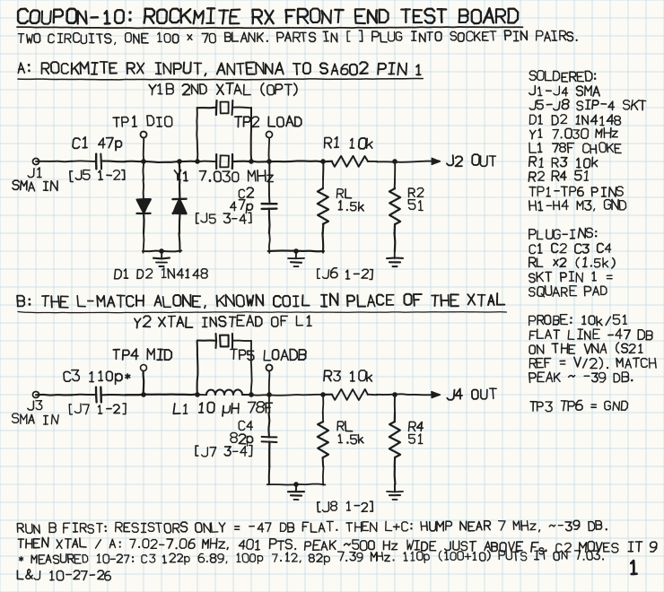
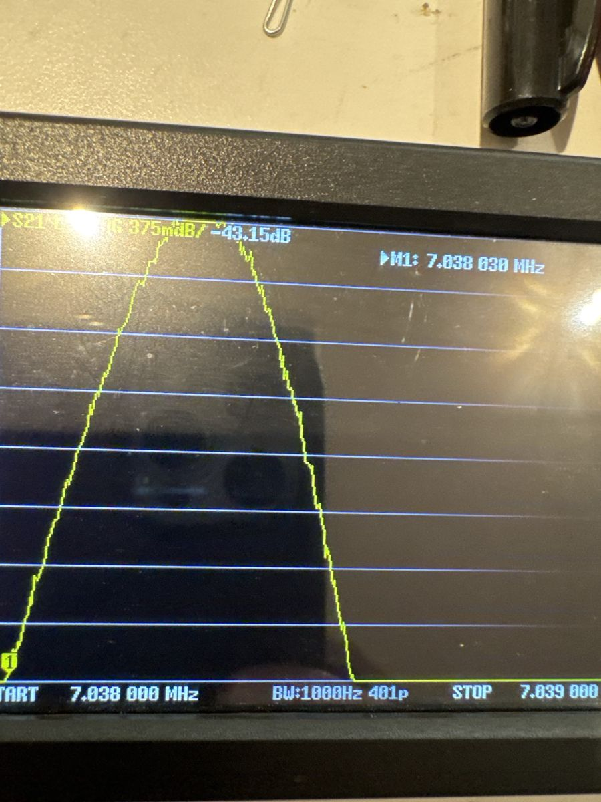

If you scanned the label on a board to get here: this is **coupon-10**, two test circuits on one blank.
{: .margin}

The RockMite's receiver has no filter other than its input crystal. The antenna comes in through a small capacitor, hits the crystal, and lands on the mixer's input with a shunt capacitor to ground. Just above its series resonance a crystal looks like an inductor, so that series-crystal / shunt-capacitor pair is an L-network stepping 50 Ω up to the mixer's kilohm-and-a-half — and it only works in the few kilohertz where the crystal is inductive. I wanted to see that, not just believe it.

Coupon A is the real input chain: C1, the diode clamp, Y1, C2 and a resistor standing in for the mixer. Coupon B is the same L-network with a known molded choke in place of the crystal. Capacitors and the load resistor plug into socket pin pairs, so a value swap is a ten-second job. Each node is tapped by a 10 k / 51 Ω divider to a second SMA so a 50 Ω analyzer can look at a high-impedance node without loading it.
{: .margin}

## Coupon B first: resistors only, then the coil

With a wire in place of C3 and no C4, the board is just resistors: source, 1.3 k load, 10 k / 51 Ω pickoff. The NanoVNA read a flat **−47.5 dB** from 1 to 20 MHz against a predicted −46.7. That one number proves the connectors, the cables, the calibration and the probe before anything interesting goes in.

Then the 10 µH choke, 82 pF shunt, and three series capacitors:

| C3 | peak | level |
|---|---|---|
| 122 pF | 6.89 MHz | −39.5 dB |
| 100 pF | 7.12 MHz | −39.3 dB |
| 82 pF | 7.39 MHz | −39.4 dB |

About 11 kHz per picofarad, and the level pinned at the matched maximum every time. 110 pF puts the coil version on 7.030.
{: .margin}

One wrong reading on the way: 82 pF first came up 4.7 dB *above* the passive maximum. A load resistor had lifted in its socket. A level that goes up is a load that has come unplugged.

## Then the crystal does the coil's job

Choke out, a 7.040 MHz crystal in the parallel pads, series cap jumpered, same 82 pF and 1.3 k:

Peak at **7.038 3 MHz, −40.2 dB** — under a decibel below the coil's ceiling, so this crystal's series resistance is small. The screen is 3 dB tall; the trace leaves the bottom at 7.038 03 and 7.038 53. **The passband is 500 Hz wide.** Loaded Q about 14 000. That is the entire selectivity of a RockMite receiver.
{: .margin}

Stepping the shunt capacitor — the RockMite's C2 — with the crystal in place:

| C4 | peak | level |
|---|---|---|
| 33 pF | 7.038 775 MHz | −41.6 dB |
| 47 pF | 7.038 625 MHz | −40.7 dB |
| 82 pF | 7.038 325 MHz | −40.3 dB |
| 100 pF | 7.038 175 MHz | −40.5 dB |

The level barely moves; the frequency moves 600 Hz — more than one passband. C2 is not a loss knob. It decides *where in the crystal's inductive window the receiver listens*, about 9 Hz per picofarad, which is what has to line up with the transmit offset.
{: .margin}

The 7.030 crystal that goes in the real board: peak 7.028 25 MHz, −41.2 dB, the same 1.7 kHz below its marking as the 7.040. Consistent batch.

What the probe cannot show: the crystal's parallel resonance, a few kilohertz up. Off resonance the crystal is only its holder capacitance, and after the pickoff's 47 dB the far skirts are below the analyzer's noise. For that, the crystal goes straight between the two ports with nothing else — a different jig, another day.

\* Coil values in the figure are the ones measured here: 10 µH Bourns 78F, 122 pF marked 120.
