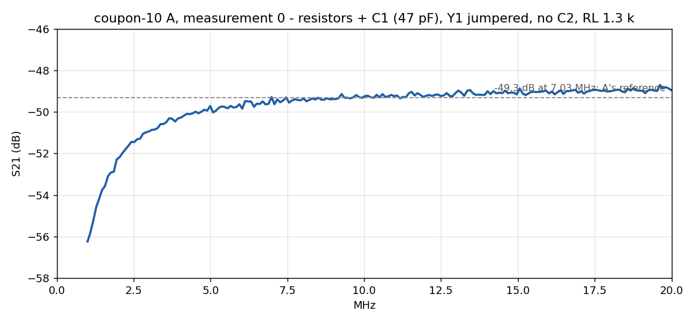
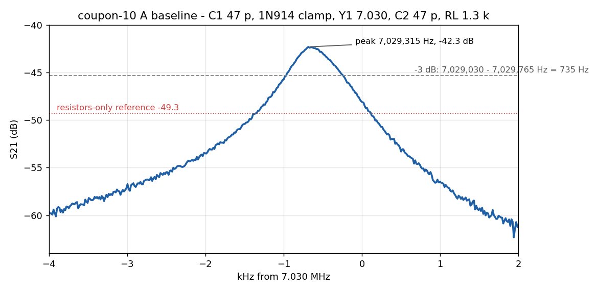
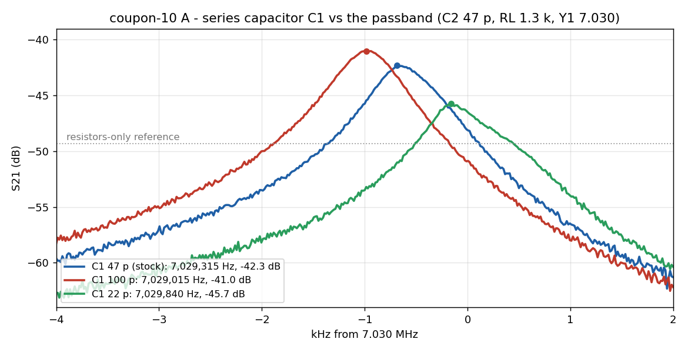

If you scanned the label on a board to get here: this is **coupon-10**, two test circuits on one blank.
{: .margin}

The RockMite's receiver has no filter other than its input crystal. The antenna comes in through a small capacitor, hits the crystal, and lands on the mixer's input with a shunt capacitor to ground. Just above its series resonance a crystal looks like an inductor, so that series-crystal / shunt-capacitor pair is an L-network stepping 50 Ω up to the mixer's kilohm-and-a-half — and it only works in the few kilohertz where the crystal is inductive. I wanted to see that, not just believe it.

Coupon A is the real input chain: C1, the diode clamp, Y1, C2 and a resistor standing in for the mixer. Coupon B is the same L-network with a known molded choke in place of the crystal. Capacitors and the load resistor plug into socket pin pairs, so a value swap is a ten-second job. Each node is tapped by a 10 k / 51 Ω divider to a second SMA so a 50 Ω analyzer can look at a high-impedance node without loading it.
{: .margin}

## Coupon B first: resistors only, then the coil

With a wire in place of C3 and no C4, the board is just resistors: source, 1.3 k load, 10 k / 51 Ω pickoff. The NanoVNA read a flat **−47.5 dB** from 1 to 20 MHz against a predicted −46.7. That one number proves the connectors, the cables, the calibration and the probe before anything interesting goes in.

Then the 10 µH choke, 82 pF shunt, and three series capacitors:

| C3 | peak | level |
|---|---|---|
| 122 pF | 6.89 MHz | −39.5 dB |
| 100 pF | 7.12 MHz | −39.3 dB |
| 82 pF | 7.39 MHz | −39.4 dB |

About 11 kHz per picofarad, and the level pinned at the matched maximum every time. 110 pF puts the coil version on 7.030.
{: .margin}

One wrong reading on the way: 82 pF first came up 4.7 dB *above* the passive maximum. A load resistor had lifted in its socket. A level that goes up is a load that has come unplugged.

## Then the crystal does the coil's job

Choke out, a 7.040 MHz crystal in the parallel pads, series cap jumpered, same 82 pF and 1.3 k:

Peak at **7.038 3 MHz, −40.2 dB** — under a decibel below the coil's ceiling, so this crystal's series resistance is small. The screen is 3 dB tall; the trace leaves the bottom at 7.038 03 and 7.038 53. **The passband is 500 Hz wide.** Loaded Q about 14 000. That is the entire selectivity of a RockMite receiver.
{: .margin}

Stepping the shunt capacitor — the RockMite's C2 — with the crystal in place:

| C4 | peak | level |
|---|---|---|
| 33 pF | 7.038 775 MHz | −41.6 dB |
| 47 pF | 7.038 625 MHz | −40.7 dB |
| 82 pF | 7.038 325 MHz | −40.3 dB |
| 100 pF | 7.038 175 MHz | −40.5 dB |

The level barely moves; the frequency moves 600 Hz — more than one passband. C2 is not a loss knob. It decides *where in the crystal's inductive window the receiver listens*, about 9 Hz per picofarad, which is what has to line up with the transmit offset.
{: .margin}

The 7.030 crystal that goes in the real board: peak 7.028 25 MHz, −41.2 dB, the same 1.7 kHz below its marking as the 7.040. Consistent batch.

What the probe cannot show: the crystal's parallel resonance, a few kilohertz up. Off resonance the crystal is only its holder capacitance, and after the pickoff's 47 dB the far skirts are below the analyzer's noise. For that, the crystal goes straight between the two ports with nothing else — a different jig, another day.

## Coupon A: the real input, 28 October

Coupon A is the circuit as K1SWL drew it: C1 in series, a pair of 1N914s back to back as the clamp (0.554 and 0.556 V on the meter — a matched pair out of a pharmacy vial), the 7.030 crystal, C2 to ground, 1.3 k standing in for the mixer. The sweeps from here on were taken by a small command-line tool talking to the NanoVNA over USB, so every curve below is a file, not a photograph of a screen.
{: .margin}

First, the same discipline as B — resistors only, with the crystal jumpered and no C2:

The 47 pF in series makes a high-pass with its knee near 2.6 MHz, so this one is not flat: −56 dB at 1 MHz climbing to −49.3 at 7 MHz and level from there. On the analyzer's own 10 dB per division screen it looked flat; a 12 dB window shows the shape. **−49.3 dB at 7.03 MHz is coupon A's reference.**
{: .margin}

Then the stock RockMite values, C1 = C2 = 47 pF:

Peak **7.029 3 MHz, −42.3 dB, 735 Hz wide**, 7 dB above the resistors-only line. That is the RockMite's receive passband with this crystal: 7.0290 to 7.0298 MHz. Notice the skirts are not symmetric — the low side falls more slowly than the high side, because the crystal's parallel resonance sits just above and steepens that edge.
{: .margin}

Does the extra hardware cost anything? Coupon B with the same crystal and 82 pF read −41.2 on a probe that sits 0.8 dB higher than A's, and the 82 → 47 pF change costs about 0.4 dB. Put those together and a lossless C1-plus-clamp would read −42.4. It read −42.3. **C1 and the diodes cost nothing measurable.** The diodes are not conducting at this level and C1 is not eating signal — what it is doing is something else.

## What C1 does

Three values of C1, everything else fixed:

| C1 | peak | level | −3 dB width |
|---|---|---|---|
| 22 pF | 7.029 84 MHz | −45.7 dB | 810 Hz |
| 47 pF (stock) | 7.029 32 | −42.3 | 735 |
| 100 pF | 7.029 01 | −41.0 | 713 |

C1 is doing two jobs with one part. It sits between the 50 Ω source and the crystal, so its reactance (−j1030 Ω at 22 pF, −j484 at 47, −j227 at 100) is in the way of the match: smaller C1, more of the source voltage dropped across the capacitor, less reaching the crystal — 4.7 dB across the range. And the crystal sees that same series capacitance as part of its own motional arm, so it also pulls the resonance: smaller C1, higher peak — 830 Hz across the range. The stock 47 pF is a compromise between a few hundred hertz of upward pull and about a decibel of sensitivity. 100 pF buys 1.3 dB and moves the passband down 350 Hz. Now it is a choice rather than a value copied from the kit.
{: .margin}

## What the board answered

- The crystal is the inductor of an L-match, and it only is one in a window a few kilohertz wide above its series resonance. Coupon B showed that with a coil first, then with the crystal.
- The match's voltage gain at the mixer node is real: about 8 dB over a plain connection, 13.6 dB over a 50 Ω termination. It adds no power; it trades current for voltage, and the SA602 input is a voltage port.
- The receive passband is about 500–750 Hz wide and there is no other filter in the receiver.
- C2 moves the passband about 9 Hz per picofarad and barely changes the level: it is where the receiver listens, not how well.
- C1 pulls the passband up and costs sensitivity as it gets smaller; the stock value trades about a decibel for a few hundred hertz.
- The 1N914 clamp is invisible at receive levels.
- Two crystals from the same batch sit 1.7 kHz below their markings, and within a few hundred hertz of each other.

Still to do: drive the clamp hard enough to see it conduct, and find the crystal's parallel resonance on a jig with no probe loss.

\* Coil values in the figure are the ones measured here: 10 µH Bourns 78F, 122 pF marked 120.
