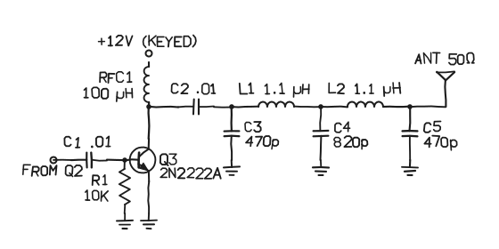

Component values here are my placeholders. The real ones go in once I've checked them against the schematic.
{: .margin}

The output stage of the K1SWL RockMite as I understand it before building: Q3 as a keyed class-C amplifier into a five-element pi low-pass. The drive comes from Q2; the +12V to the collector choke is what gets keyed, so the stage is dead between dits.

Q3 is a 2N2222A. Keep its leads short. L1 and L2 are 17 turns of #26 on T37-2. C3 to C5 want NP0 or silver mica.
{: .margin}

## Power out (scope method)

This is the method I used on the Tuna Tin 2, so the two rigs can be compared on the same scale.
{: .margin}

POUT = VPP2 / (8 × RL), with RL = 50Ω.

| Rig | VPP into 50Ω | POUT | Supply |
|---|---|---|---|
| TT2 40th | 11.4 V | 325 mW | 13 V, 87 mA |
| RockMite | — | — | — |
| 5 W reference | 63 V | 5 W | — |

## Before first power

- Check L1/L2 on the LC meter before they go in.
- Dummy load on the output. Scope across it.
- Key down for seconds, not minutes, until the collector current looks sane.

\* Values approximate. Confirm against the K1SWL schematic.
{: .foot}
