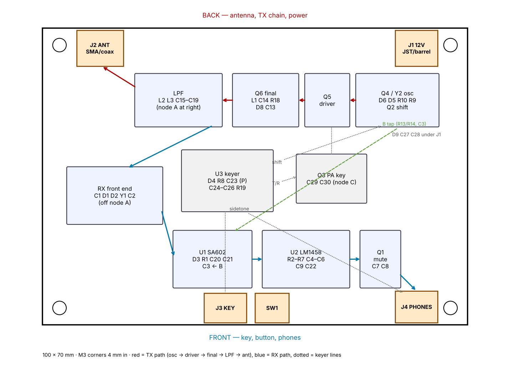
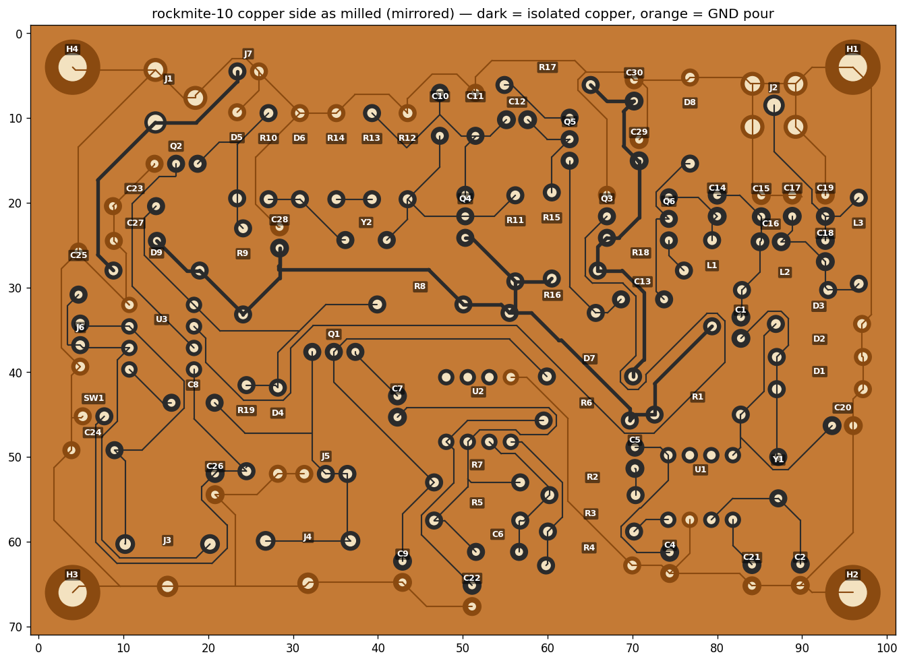
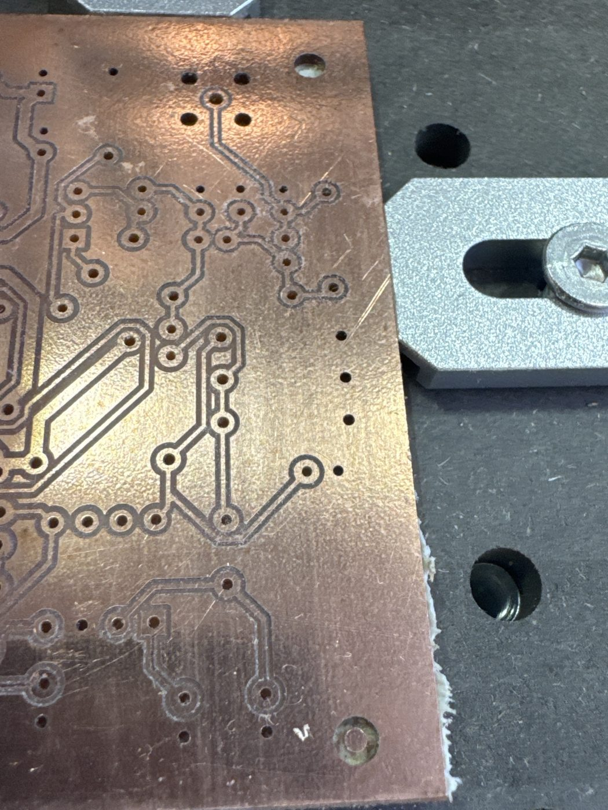

If you scanned the label on a board to get here: this is board **rockmite-10**, the first one.
{: .margin}

Dave Benson K1SWL's RockMite, 40 m CW, built from the schematic rather than the kit: receiver, crystal transmitter, keyer and sidetone on one 100 × 70 mm single-sided board. Milled copper-up on a Makera Carvera with a 0.2 mm V-bit, parts on the plain side, leads through to the copper. No vias, no jumper wires — every net routed on one layer, 421 track segments, and a ground pour over the rest.

The layout, as planned. The RF chain runs along the top edge — antenna jack at the left, low-pass filter, driver and final, the oscillator — with the receiver and audio underneath. Grounds reach toward the top edge on the transmit strip and toward the bottom on the receive strip, so the pour has somewhere to go.
{: .margin}

## The copper side

Mirrored, because you look at it from the copper side. Dark is isolated copper — pads and tracks; the orange is ground. Ground pads have no ring at all: the pour simply closes over them.
{: .margin}

Board one came off the machine with the right-hand third barely scratched — Auto Z Probe was ticked, Auto Leveling was not, and the stock rises a few hundredths toward that side. A second isolation pass at −0.080 mm with leveling on finished it. The lesson went straight into the checklist.
{: .margin}

## Numbers

| | |
|---|---|
| Board | 100 × 70 mm, 1.5 mm FR-4, single-sided |
| Parts | 83 footprints, 194 holes |
| Tracks | 0.4 mm signal, 1.0 mm on +12 V and the keyed PA return |
| Clearance | 0.30–0.40 mm to the pour — a band, not just a minimum, because wider gaps leave copper whiskers between the two passes |
| Tool | 0.2 mm 30° V-bit, 0.28 mm measured kerf, two passes at 0.14 and 0.27 mm offset, 0.065 mm deep |
| Drill | 0.8 mm bit, helical for anything larger |
| Cut | 2026-10-26, about 21 minutes of isolation plus the drill cycle |

Next: stuff it, bring it up stage by stage. The input stage got its own test board first — that's the next page.
