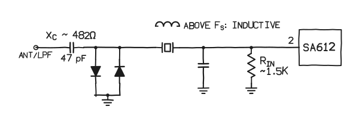
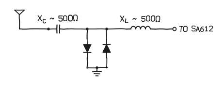
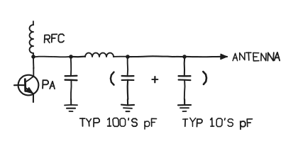

From my notebook, 20 Oct. Page 1 of five; the L-network math is the next page.
{: .margin}

## RX front end

The crystal, run just above its series resonance, looks inductive. It is the inductor in the section below.
{: .margin}

The RockMite uses a crystal for narrowband RF filtering and a pair of shunt diodes. Together they do the T/R switching.

The article credits W7EL for the circuit. The investigation that followed is written up in EMRFD.

It breaks down into two sections: the T/R section, below, and the L-network into the 612, next page.

## The T/R section

Receiving: the diodes look like a few picofarads, so neglect them. What is left is a series resonant circuit.

Transmitting: the diodes look like a short to ground. The mixer input is clamped to ±0.6 V, and the coupling cap lands across the LPF output.

## Transmit: PA + LPF

The LPF output cap and the coupling cap, now in parallel.
{: .margin}

\* XC is 47 pF at 7.03 MHz; the 500Ω figures are round numbers.
{: .foot}
